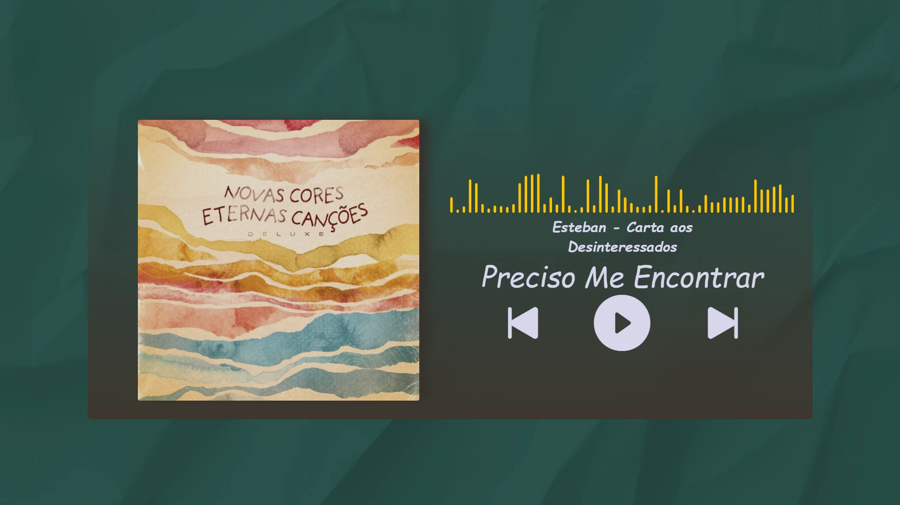

# Topa-Vinil-



Um player de música para web, com uma playlist de artistas brasileiros, pensado para quem quer um "vinil" para ouvir enquanto precisa se encontrar. A interface é simples: uma capa, o título da faixa atual e os controles de tocar/pausar, anterior e próxima.

## Funcionalidades

- Reprodução e pausa da faixa atual pelo botão central.
- Botões para ir para a faixa anterior e para a próxima.
- Passagem automática para a próxima faixa quando a atual termina.
- Ao chegar ao fim da playlist, a reprodução volta para a primeira faixa.
- Exibição do título da faixa que está tocando.
- Animação (Lottie) indicando o status de reprodução.

## Tecnologias

- HTML5
- CSS3
- JavaScript (módulo ES, sem frameworks)
- Bootstrap Icons, carregado via jsDelivr
- lottie-player, carregado via unpkg

## Estrutura

```
Topa-Vinil-/
├── index.html    # interface do player
├── style.css     # estilos
├── main.js       # lista de faixas e controles de reprodução
├── images/       # capa e ícones
└── playlist/     # arquivos de áudio (.mp3)
```

## Como executar

Não há build nem dependências. Basta abrir o arquivo `index.html` no navegador.

Se o navegador bloquear a reprodução ou o carregamento dos arquivos, sirva a pasta com um servidor local simples (por exemplo, `python -m http.server`) e acesse pelo endereço indicado. Esse passo é uma sugestão, não um requisito do código.

## Observações

- A lista `playlist` em `main.js` tem 13 faixas, mas somente 3 arquivos `.mp3` estão versionados na pasta `playlist/`. As demais faixas não tocarão enquanto os arquivos não forem adicionados (a confirmar).
- A faixa inicial definida em `index.html` também não está versionada na pasta `playlist/`.
- O fundo da página e a animação do lottie são carregados de URLs externas.
- A distribuição dos arquivos de áudio depende dos direitos de uso de cada faixa (a confirmar).

## Autor

Desenvolvido por [Juliano Sobrinho](https://github.com/JuhhSobrinho).
